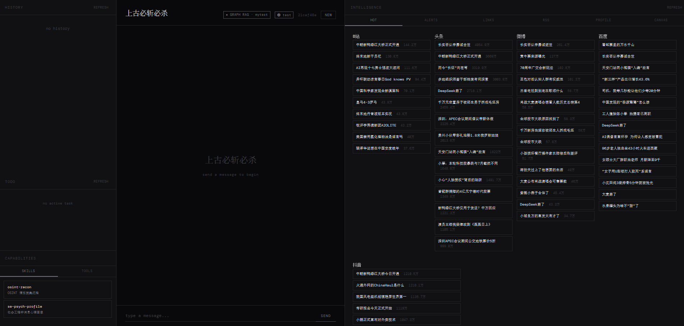
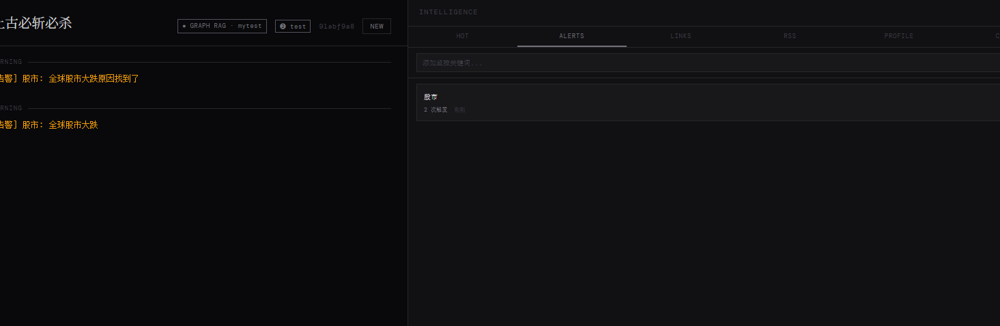
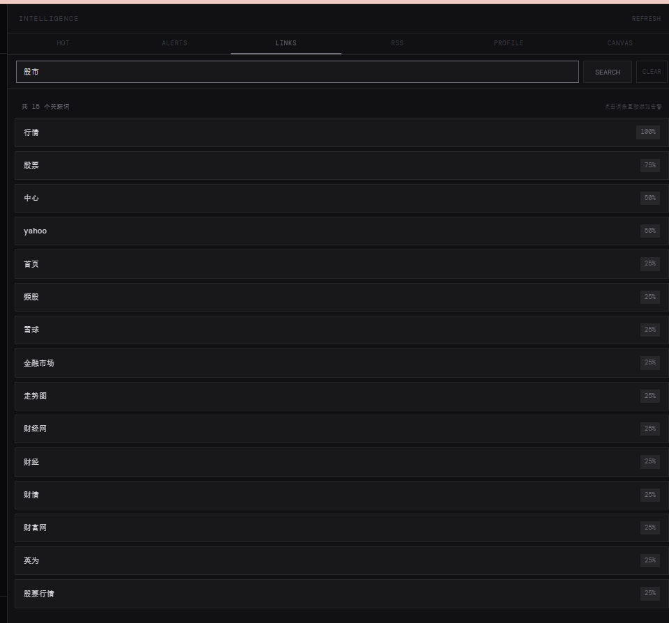
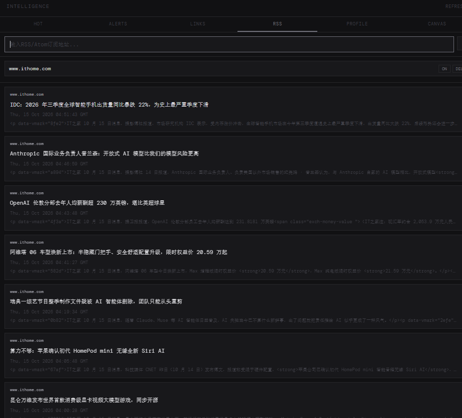
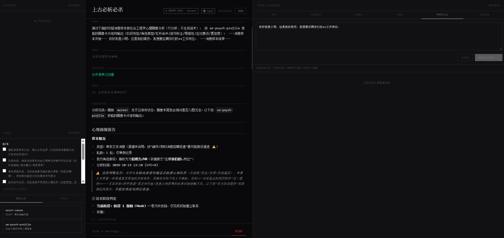
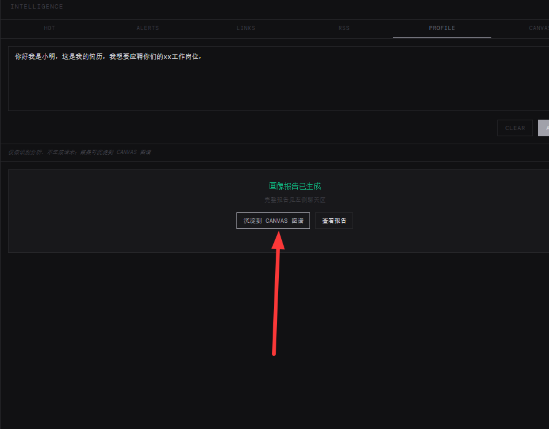
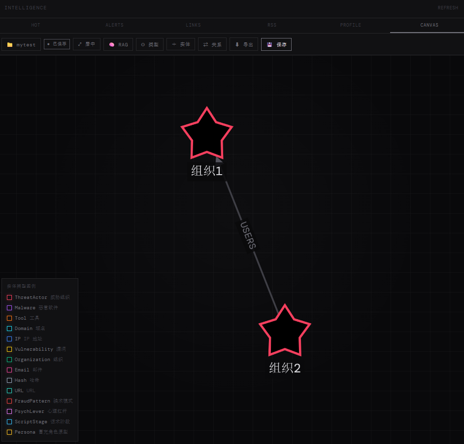
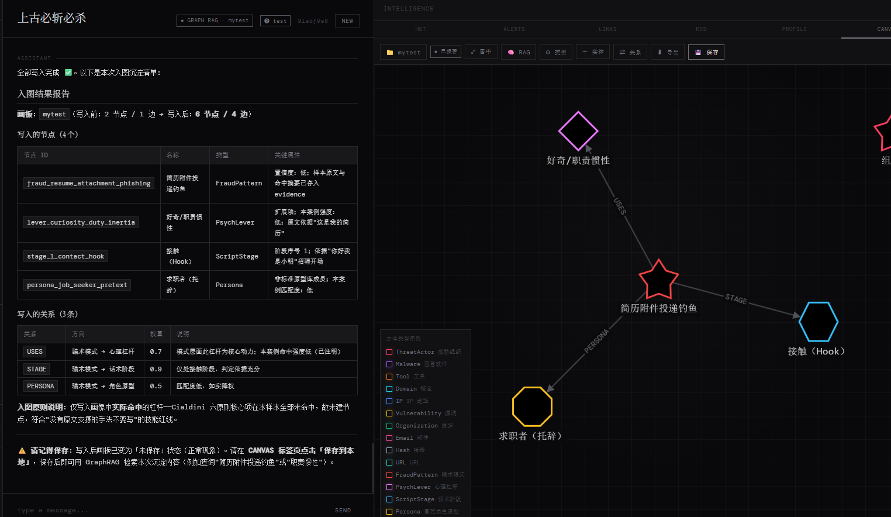

# 上古必斩必杀

AI Intelligence Assistant for Social-Engineering Defense - Built with LangChain + Anthropic-compatible models

> Language: English ｜ [中文](README.md)

## Project Overview

上古必斩必杀 is an AI intelligence-analysis assistant focused on **social-engineering (SE) defense**, built around the loop of "recognize scripts → analyze psychology → sediment intelligence":

- **Message Psychology Profiling**: paste a suspicious message sample (chat / SMS / email / customer-service conversation) to generate a seven-section defense report (script-stage determination / psychological-lever hits / impersonated persona / sentence-by-sentence breakdown / group susceptibility)
- **OSINT Intelligence Gathering**: built-in recon skill (`skills/osint-recon/`), multi-platform public-information search and association analysis
- **Intelligence Board**: local knowledge-graph visualization + GraphRAG data preparation (multi-board management, 14 entity types incl. FraudPattern / PsychLever / ScriptStage / Persona, one-click index export)
- **GraphRAG Conversation**: once a board is saved, the Agent auto-connects graph-retrieval tools to answer questions about board entities
- **Intelligence Monitoring**: multi-platform hot-search aggregation, keyword alerts and RSS subscriptions to track emerging scam trends
- **Smart Conversation**: Anthropic-protocol-compatible LLMs (Claude / GLM, etc.) with auto-iterating task execution
- **Task Management**: Auto-generate and manage TODO lists
- **Tool Calling**: Support for multiple tools (file operations, command execution, graph query & write, etc.)

> **Red lines**: analysis only, never generation — refuses to write/optimize any manipulation scripts, no psychological profiles of real individuals, group-level assessment only.

## UI Preview



## Tech Stack

- **Backend**: Python 3.11+, FastAPI, **LangChain**, LangGraph
- **AI Model**: Anthropic-compatible API (reads `ANTHROPIC_*` env vars by default)
- **Chinese Segmentation**: jieba (Chinese keyword extraction for association analysis)
- **Frontend**: Native HTML/CSS/JavaScript
- **Architecture**: Agent architecture with tool calling and auto-iteration
- **Reference**: LangChain, DeepAgents

## Project Structure

```
onekiil4all/
├── web/                      # Web server code
│   ├── web_server.py         # FastAPI app assembly (lifespan/static/routes)
│   ├── background_tasks.py   # Background tasks (alert check / RSS fetch loops)
│   ├── chat_handler.py       # Chat handler (token-level streaming)
│   ├── message_utils.py      # Message conversion utils
│   ├── conversation.py       # Conversation management
│   ├── task_analyzer.py      # Task analyzer (completion check)
│   ├── task_cache.py         # Task status cache
│   ├── task_prompts.py       # Task analysis prompt builders
│   ├── todo_manager.py       # TODO manager
│   ├── todo_prompts.py       # TODO prompt builders
│   ├── sessions.py           # Session store (bounded)
│   ├── chat_history_store.py # Chat history (JSONL append)
│   ├── sse.py                # SSE formatting + per-connection broadcast
│   ├── paths.py              # Project path constants (anchored to root)
│   ├── api/                  # API routers (split by responsibility)
│   │   ├── chat_api.py       # Chat SSE streaming
│   │   ├── session_api.py    # Sessions / TODO query
│   │   ├── history_api.py    # Chat history CRUD
│   │   ├── meta_api.py       # Skills/tools routes
│   │   ├── intelligence_api.py # Trends / associations
│   │   ├── alert_api.py      # Alert rules / history / SSE
│   │   └── rss_api.py        # RSS sources / articles / SSE
│   └── intelligence/         # Intelligence module
│       ├── trends/           # Trending data package (split by responsibility)
│       │   ├── __init__.py   # Entry (get_trends + cache)
│       │   ├── parsers.py    # Platform parse pure functions
│       │   ├── fetchers.py   # Network fetching + concurrency
│       │   ├── keywords.py   # Chinese/English keyword extraction
│       │   └── associations.py # Keyword association analysis
│       ├── alert_manager.py  # Alert management
│       ├── alert_models.py   # Alert data models
│       ├── rss_manager.py    # RSS subscription store
│       └── rss_parser.py     # Shared RSS/Atom parsing
├── agent_set/                # Agent components
│   ├── agent_set.py          # Agent creation (CompositeBackend workspace routing)
│   ├── workspace.py          # Workspace state (folder required before chatting; persisted to data/workspace.json)
│   ├── tools/                # Tool set package (split by responsibility)
│   │   ├── __init__.py       # Tool list export
│   │   ├── shell.py          # PowerShell command execution
│   │   ├── files.py          # File read/write (paths anchored to current workspace)
│   │   └── search.py         # Web search + RSS fetch│   │   ├── graphrag.py       # Board status + GraphRAG search + graph write tools
│   │   └── todo.py           # Task list read/update tools│   └── skill_set.py          # Skill configuration
├── model_set/                # Model configuration
│   └── model_set.py          # Model configuration (ANTHROPIC_* env vars)
├── static/                   # Frontend static resources
│   ├── index.html            # Main page
│   ├── style.css             # Stylesheet
│   ├── config.js             # Configuration and constants
│   ├── state.js              # Global state
│   ├── dom.js                # DOM element cache
│   ├── utils.js              # Utility functions
│   ├── chat.js               # Chat functionality
│   ├── history.js            # History records
│   ├── todo.js               # Todo items
│   ├── skills.js             # Skills/tools
│   ├── init.js               # Initialization and event binding
│   ├── alert.html            # Alert detail page
│   ├── alert.js              # Alert detail page logic
│   ├── alert.css             # Alert detail page styles
│   └── intelligence/         # Intelligence module
│       ├── trends.js         # Trending data
│       ├── alerts.js         # Alert functionality
│       ├── links.js          # Association search
│       ├── rss.js            # RSS subscription
│       └── profile.js       # Message psychology profiling
├── tests/                    # pytest tests
├── data/                     # Runtime data storage (generated, gitignored)
├── prompt/                   # Prompt configuration
│   └── AGENTS.md             # Agent system prompts
├── skills/                   # Project-local skills (one folder + SKILL.md each)
│   ├── osint-recon/          # Built-in: OSINT intelligence gathering workflow
│   └── se-psych-profile/     # Built-in: SE message psychology profiling framework
├── chat_history/             # Conversation history storage (runtime, gitignored)
├── pyproject.toml            # Project configuration
└── README.en.md              # Project documentation
```

## Features

### 1. Smart Conversation

- Continuous conversation with context memory (history restored from JSONL persistence, survives server restart)
- Automatic task decomposition and execution
- SSE streaming responses
- **Interruptible**: STOP button appears while the agent is processing; clicking it interrupts immediately. Partial responses are auto-saved to history (marked `interrupted`), TODO is preserved (task incomplete)

### 2. TODO Task Management

- **Auto-creation**: Automatically generates task list when user input >= 20 characters
- **Smart Updates**: AI automatically analyzes task completion status
- **Manual Skip**: Short inputs are answered directly without creating TODO

### 3. Tool Calling

The system includes multiple built-in tools:

| Tool Name | Description |
|-----------|-------------|
| run_powershell | Execute PowerShell commands |
| write_file | Write file content |
| read_text_file | Read text file content |
| read_binary_file | Read binary file content |
| fetch_rss_feed | Fetch and parse RSS/Atom feeds |
| web_search | Search the web using DuckDuckGo |
| graphrag_status | Check current intelligence board status (board name / saved state / counts) |
| graphrag_query | GraphRAG search of current board entities (name/type/description/properties/sources) |
| graph_add_node | Write/update an entity node on the current board (SE analysis sedimentation; works whenever a board is open, batch-friendly) |
| graph_add_edge | Write/update a relationship edge (uppercase relations like USES/STAGE/PERSONA) |

> Note: `graphrag_query` only works when the current board is **saved**; otherwise it returns guidance. Agent queries follow the current board automatically after switching. `graph_add_node` / `graph_add_edge` only require a board to be **open** (writes flip the board to unsaved, which is expected — batch writes are fine, the user saves once in CANVAS at the end); **the Agent must obtain user consent before writing**.

### Workspace-First Design

Before entering the agent loop, the page requires the user to pick a **workspace folder** (`agent_set/workspace.py`, persisted to `data/workspace.json`). Every time a new session id is generated (first visit or clicking NEW), the picker reopens and the user must confirm before chatting; the header badge allows manual switching anytime. The picker accepts a typed path, or click BROWSE to open a native OS folder dialog served by the backend (`GET /api/workspace/browse`; cancelling leaves the input untouched). The agent's file backend is a `CompositeBackend`: the default backend is anchored to the workspace, while `/prompt/` and `/skills/` prefixes are fixed routes to the project's `prompt/` and `skills/` directories. All built-in file tools (`ls / read_file / write_file / edit_file / glob / grep / delete`) operate on the **real disk**, artifacts are saved inside the workspace by default, and files written are immediately readable/editable/searchable. If no workspace is selected, the chat API returns 409 and the picker reopens.

### 4. Intelligence Panel

- **INTELLIGENCE Panel**: Display trending searches (self-built multi-platform fetching, direct official APIs, no third-party aggregator)
  - HOT: Aggregated trending from multiple platforms (Baidu, Weibo, Zhihu, Douyin, Bilibili, etc.)
  - ALERTS: Keyword monitoring and alerts
  - LINKS: Keyword association analysis
  - RSS: Custom RSS subscription
  - PROFILE: Message psychology profiling (see section 8)
- All items are clickable and link to original pages

### 5. Keyword Monitoring & Alerts



- **Add Monitoring**: Enter keywords in ALERTS tab to add monitoring
- **Auto-detection**: Background task checks trending data every 30 seconds (data cached for 30s), alerts immediately on match
- **Real-time Push**: SSE pushes new alerts to frontend instantly (single-layer event forwarding, fields directly readable)
- **New-Alert Badge**: unread count badge on ALERTS tab, pulsing highlight on rule/history items, cleared when switching to the tab
- **Rule Stats**: each rule displays trigger count and last trigger time (returned by `/api/alerts`, no extra request)
- **Instant Local Render**: new alerts are prepended to history locally and counters updated, with a 5s throttled re-sync
- **Reconnect Compensation**: after SSE reconnects, rules and history are re-fetched so missed alerts are not lost
- **Multi-tab Sync**: rule changes broadcast an `alert_updated` event; other tabs refresh automatically
- **Event Timeline**: click keyword to view complete alert history
- **Persistent Storage**: alert rules and history stored in `data/` directory
- **Duplicate Detection**: same keyword (case-insensitive) cannot be added, shows "already exists"

### 6. Keyword Association Analysis



- **Association Search**: Enter any keyword (Chinese or English) in LINKS tab
- **Web Search + AI Summary**: fetches related web page titles via search engines (DuckDuckGo / Bing), then the project AI model summarizes 5-12 highly relevant keywords (brands/products/entities, mixed Chinese/English)
- **Two-level Smart Fallback**:
  1. If the AI model call fails (content-moderation rejection, rate limit, timeout), keywords are extracted directly from the already-fetched search titles (jieba Chinese segmentation + English words, stopword-filtered) — keeps person/place names (e.g. Iran, Trump) working even when the model refuses to answer
  2. If search itself returns nothing, falls back to built-in trending data analysis (both Chinese and English keywords), keeping the feature available
- **Chinese Keyword Support**: jieba segmentation extracts Chinese keywords with Chinese stopword filtering; Chinese keywords no longer return empty results
- **Result Caching**: repeated searches for the same keyword hit a 60s cache
- **One-click Alert**: click any associated keyword to add it to ALERTS (duplicates show "already exists"; the new rule is highlighted on success)
- **Relevance Score**: percentage based on the AI-ranked relevance order

### 7. RSS Subscription



- **Add Subscription**: Enter RSS/Atom URL in RSS tab to add
- **Format Support**: supports RSS 2.0, RSS 1.0 (RDF/XML) and Atom XML formats
- **Instant Display**: articles are fetched and shown immediately after adding a source, no manual refresh needed (background task still updates periodically)
- **Duplicate Detection**: Same URL (case-insensitive) cannot be added, shows "URL already exists"

### 8. Message Psychology Profiling (PROFILE / Social-Engineering Defense Analysis)



In the **PROFILE** tab of the INTELLIGENCE panel, paste a suspicious message sample (chat log / SMS / email / customer-service conversation) to generate a **defense-only** psychology profiling report:

- **Seven-section report**: ① script-stage determination ② impersonated persona archetype ③ psychological-lever hit table (authority/urgency/fear/greed/social-proof/reciprocity/isolation/shame, with original-text citations and intensity) ④ sentence-by-sentence annotation of manipulation tactics and flaws ⑤ group-level susceptibility assessment (which groups are at risk, never specific individuals) ⑥ detection & response tips (e.g. 96110 hotline, 24h cooling-off) ⑦ confidence & limitations
- **Built-in analysis framework**: the `skills/se-psych-profile/` skill ships a psychological-lever checklist, five-stage script model and persona archetype library; the Agent follows it automatically
- **Red lines**: analysis only, never generation — refuses to write/optimize any manipulation scripts, no psychological profiles of real individuals, group-level assessment only
- **Sediment to CANVAS**: after the report, one click writes the fraud pattern / levers / stages / persona into the intelligence board (with user consent, via `graph_add_node` / `graph_add_edge`, FraudPattern as the hub with USES/STAGE/PERSONA relations)
- **Visible failures**: model-call failures now show an explicit error in the panel instead of an empty success card (the chat area shows the red error too)



### 10. Intelligence Board (CANVAS / GraphRAG)

Integrated from GraphRAG Viz, available in the **CANVAS** tab of the INTELLIGENCE panel:



- **Multi-board management**: each board is a standalone JSON file (`data/graphs/*.json`); create / switch / rename / delete
- **Graph visualization**: Cytoscape force-directed layout, drag/zoom/pan/fit
- **Entity & relationship editing**: add/edit entities (GraphRAG description, properties, source chunks), drag-to-connect or manual relationship creation
- **Entity type management**: 14 built-in entity types (10 technical intel types ThreatActor / Malware / Domain / IP, etc. + 4 social-engineering types FraudPattern / PsychLever / ScriptStage / Persona) plus custom types (name/label/color/shape); legacy boards auto-backfill newly added built-in types on open
- **Intel drill-down**: click a node for full details; right-click to 1-hop expand, generate RAG context, or delete
- **GraphRAG retrieval**: generate 1~2 hop semantic triplets Prompt Context and export standard GraphRAG index (MS GraphRAG / LlamaIndex compatible)
- **Saved-state check**: chat header shows `● GRAPH RAG · board` (saved/connected) or `○ not saved`; board toolbar shows saved/unsaved badge
- **Agent auto-connect**: once the board is **saved**, the Agent can use `graphrag_status` / `graphrag_query` to answer questions about board entities; `graph_add_node` / `graph_add_edge` work whenever a board is open (batch sedimentation: writes flip the board to unsaved, which is expected — save once at the end)

Result of sedimenting a psychology profile into the graph:



### 9. Frontend Features

- **Real-time Progress**: Tool calling and task status update in real-time
- **Responsive Design**: Adapts to different screen sizes
- **Left Sidebar**: Displays HISTORY + TODO + CAPABILITIES
- **Right Sidebar**: INTELLIGENCE panel (50% width)
- **Chat Area**: 33% width

## Quick Start

### Requirements

- Python 3.11 or higher
- Anthropic-compatible API credentials (`ANTHROPIC_AUTH_TOKEN` or `ANTHROPIC_API_KEY`)

### Installation

1. Clone the project:

```bash
git clone https://github.com/CuteCuteYu/onekiil4all.git
cd onekiil4all
```

2. Install dependencies:

```bash
uv sync
```

3. Configure environment variables:

Model configuration reads `ANTHROPIC_`-prefixed environment variables by default (credentials set by Claude Code / Zhipu etc. can be reused directly):

| Variable | Description | Default |
|----------|-------------|---------|
| `ANTHROPIC_AUTH_TOKEN` | Auth credential (Bearer; either this or API_KEY) | (required) |
| `ANTHROPIC_API_KEY` | Auth credential (x-api-key) | (required) |
| `ANTHROPIC_BASE_URL` | API endpoint | `https://api.anthropic.com` |
| `ANTHROPIC_MODEL` | Model name | `claude-sonnet-4-5` |

Or create a `.env` file:

```bash
ANTHROPIC_AUTH_TOKEN=your_token_here
ANTHROPIC_BASE_URL=https://open.bigmodel.cn/api/anthropic
ANTHROPIC_MODEL=GLM-4.7
```

4. Start the service:

```bash
uv run python -m web.web_server
```

5. Access the interface:

Open browser and visit `http://localhost:8000`

## Usage Guide

### Basic Conversation

1. Enter your question in the input box
2. Click SEND or press Enter to send
3. AI will automatically answer your question

### Creating Tasks

When input exceeds 20 characters, the system will automatically:

1. Analyze user requirements
2. Generate task list (TODO)
3. Execute steps sequentially
4. Display execution progress in real-time

### Tool Calling

The system automatically determines if tool calling is needed:

- Read/Write files: Use file-related tools
- Execute commands: Use run_powershell

All tool calls display real-time progress on the frontend.

## Configuration

### Model Configuration

Modify `model_set/model_set.py` to change the model (or configure via the `ANTHROPIC_*` environment variables above):

```python
model = ChatAnthropic(
    model=model_name,  # ANTHROPIC_MODEL
    api_key=convert_to_secret_str(
        auth_token
    ),  # ANTHROPIC_AUTH_TOKEN / ANTHROPIC_API_KEY
    base_url=base_url,  # ANTHROPIC_BASE_URL
)
```

### Tool Configuration

Modify `agent_set/tools_set.py` to add or modify tools.

### Task Threshold

Modify `len(message.strip()) >= 20` in `web/api/chat_api.py` to adjust TODO creation threshold.

## API Endpoints

The service provides the following REST APIs:

| Endpoint | Method | Description |
|----------|--------|-------------|
| `/` | GET | Returns frontend page |
| `/alert` | GET | Alert detail page |
| `/static/*` | GET | Static resources |
| `/api/chat` | POST | Send chat message (SSE streaming) |
| `/api/new` | POST | Create new conversation |
| `/api/sessions` | GET | List all sessions |
| `/api/history` | GET | Get conversation history |
| `/api/history/{tid}` | GET | Get specific conversation |
| `/api/history/{tid}` | DELETE | Delete conversation |
| `/api/todo` | GET | Get TODO list |
| `/api/skills` | GET | Get available skills |
| `/api/tools` | GET | Get available tools |
| `/api/trends` | GET | Get trending and intelligence info |
| `/api/alerts` | GET/POST | Get alert rules (with trigger count & last trigger time) / create rule |
| `/api/alerts/{id}` | DELETE | Delete alert rule |
| `/api/alerts/{id}/toggle` | POST | Toggle alert status |
| `/api/alerts/history` | GET | Get alert history |
| `/api/alerts/history/all` | DELETE | Clear alert history |
| `/api/alerts/timeline/{keyword}` | GET | Get keyword timeline |
| `/api/alerts/stream` | GET | SSE alert stream (real-time push) |
| `/api/rss` | GET/POST | Get/create RSS subscription |
| `/api/rss/{id}` | DELETE | Delete RSS source |
| `/api/rss/{id}/toggle` | POST | Enable/disable RSS source |
| `/api/rss/articles` | GET | Get all RSS sources latest articles |
| `/api/rss/stream` | GET | SSE RSS article stream (real-time push) |
| `/api/boards` | GET/POST | List boards & current board / create empty board |
| `/api/boards/open` | POST | Open a board and load into memory |
| `/api/boards/rename` | POST | Rename a board |
| `/api/boards/{name}` | DELETE | Delete a board (auto-switch if deleting current) |
| `/api/graph` | GET | Read current board graph data |
| `/api/graph/status` | GET | Board status (opened / saved / node & edge counts, for GraphRAG connection) |
| `/api/types` | GET/POST | Get all entity types / upsert custom type |
| `/api/types/{type_name}` | DELETE | Delete custom type (built-ins protected) |
| `/api/expand/{node_id}` | GET | 1-hop neighbor subgraph |
| `/api/node` | POST | Create / update node |
| `/api/node/{node_id}` | DELETE | Delete node with cascade edge cleanup |
| `/api/edge` | POST | Create / update relationship |
| `/api/save` | POST | Persist current board to file |
| `/api/rag/context/{node_id}` | GET | 1~2 hop semantic triplets + entity descriptions (Prompt Context) |

## RSS Subscription Feature

### Description

- **Add Subscription**: In INTELLIGENCE panel's RSS tab, enter RSS/Atom URL to add
- **Scheduled Fetch**: Each source fetched every 60 seconds by default (check interval 10 seconds); failed fetches also count toward the interval (natural backoff)
- **Real-time Push**: New articles pushed to frontend via SSE
- **Article Storage**: Each source keeps latest 10 articles

### Usage Example

Add RSS subscription:
```bash
curl -X POST http://localhost:8000/api/rss \
  -H "Content-Type: application/json" \
  -d '{"url": "https://www.ruanyifeng.com/blog/atom.xml"}'
```

### Graceful Shutdown

**Important**: Close browser tab first to disconnect SSE connections before pressing Ctrl+C.

Exit steps:
1. Close browser tab (or refresh to disconnect SSE connections)
2. Press Ctrl+C to exit

If Ctrl+C does not work, run `stop.bat` (Windows) / `./stop.sh` (Linux/macOS). It kills the port listener, any process whose command line contains `web.web_server`, **and uvicorn reloader orphan workers** (command line contains only `spawn_main`; the port owner PID may point at an already-dead parent), then polls until the port is actually free.

## Performance Optimization

### Multi-threading Concurrency

- **Trending Data Fetching**: Uses `ThreadPoolExecutor` to fetch data from multiple platforms concurrently, reducing time from ~165 seconds (sequential) to ~2 seconds
- **Background Alert Checking**: Uses `asyncio.to_thread()` to avoid blocking main event loop, ensuring smooth UI responsiveness
- **Alert Matching Optimized**: keywords lowercased once and matches collected outside the lock; event creation serialized under an `AlertManager` thread lock, avoiding duplicate conversion and concurrent writes
- **Single-Layer SSE Events**: broadcasters publish complete event messages and SSE endpoints forward them as-is (fixes the historical double-wrapping of alert/rss events)
- **Graceful Shutdown**: Properly closes background tasks and thread pool on service stop, preventing Ctrl+C hang

### Technical Details

```python
# trends.py - concurrent fetching
_executor = ThreadPoolExecutor(max_workers=8)
futures = {_executor.submit(_fetch_platform, p): p for p in platforms}
```

```python
# web_server.py - async execution
trends = await asyncio.to_thread(get_trends, check_alerts=True)
```

```python
# web_server.py - graceful shutdown
alert_checker_task.cancel()
await asyncio.wait_for(alert_checker_task, timeout=2.0)
_executor.shutdown(wait=False)
```

## FAQ

### Q: How to get API Key?

A: Any Anthropic-protocol-compatible platform works (Anthropic official, Zhipu open.bigmodel.cn, etc.). Existing ANTHROPIC_* environment variables (e.g. from Claude Code) can be reused directly.

### Q: Why do tool calls fail?

A: Check if PowerShell is available and if commands have permission to execute.

### Q: How to modify the model?

A: Modify the model configuration in `model_set/model_set.py`, supports OpenAI-compatible APIs.

### Q: How to adjust sidebar width?

A: Move mouse to sidebar edge, when double-arrow cursor appears, drag to resize.

## Contributing

Feel free to submit Issues and Pull Requests!

## License

MIT License

## Acknowledgments

- [LangChain](https://github.com/langchain-ai/langchain) - LLM application framework
- [Anthropic Claude](https://www.anthropic.com/) - LLM API protocol
- [DeepAgents](https://github.com/deepagents) - Agent framework
- Weibo/Baidu/Toutiao/Bilibili/Douyin - hot search data sources
- [HackerNews API](https://github.com/HackerNews/API) - tech news data source
